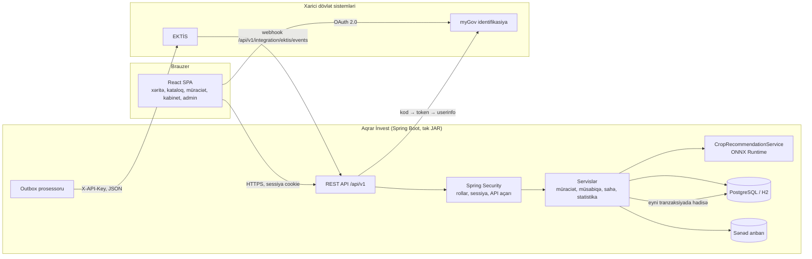
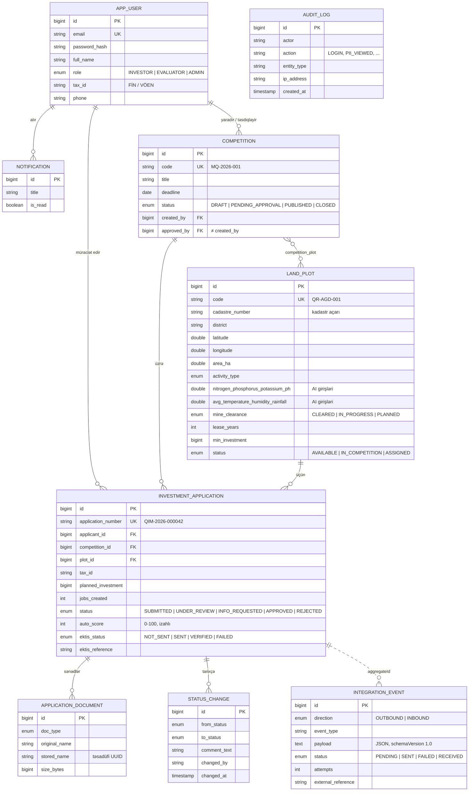
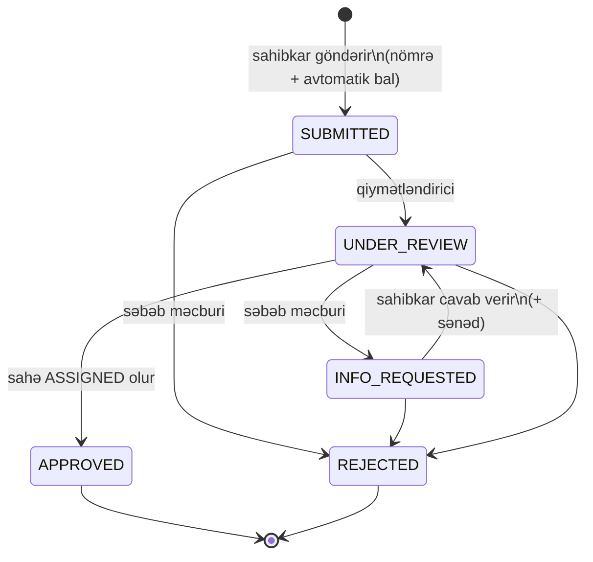
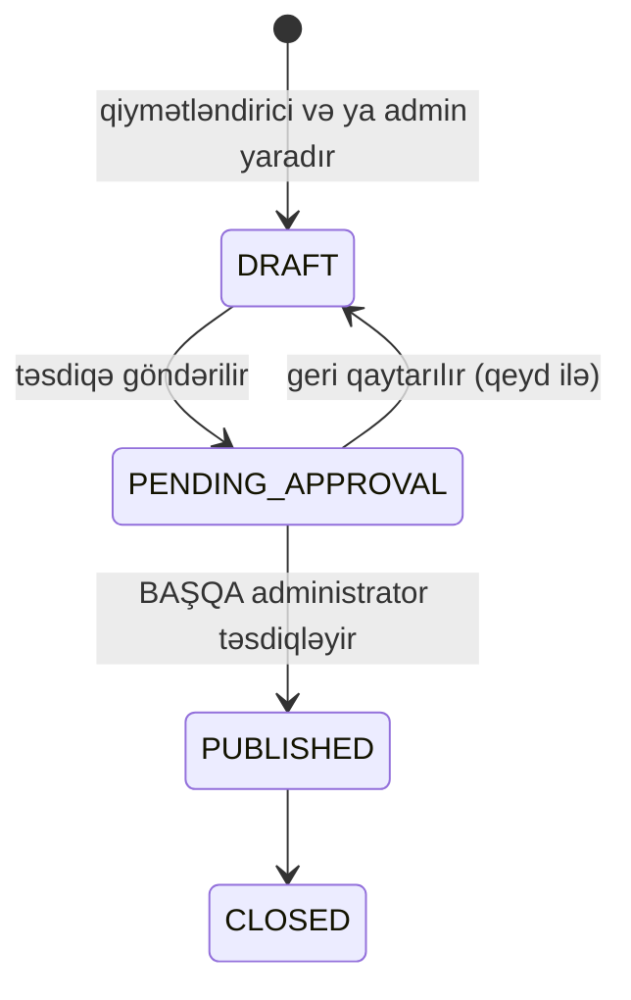
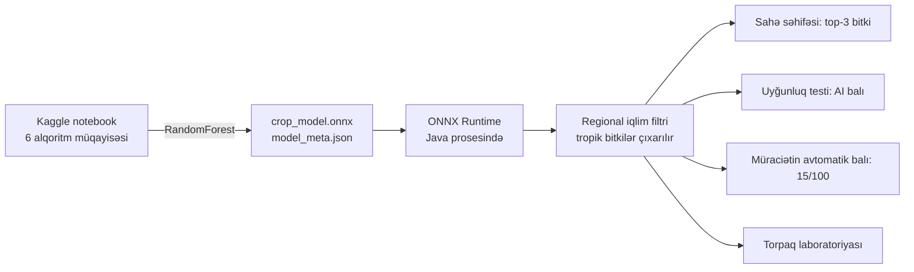

# Arxitektura və məlumat modeli

## Ümumi baxış

**Qatlar** (`backend/src/main/java/az/agro/portal`):

| Paket | Məsuliyyət |
|---|---|
| `domain` | JPA entity-lər və status maşınları (`ApplicationStatus.allowedNext()`) |
| `repo` | Spring Data repozitoriyaları |
| `service` | Biznes qaydaları: müraciət, qiymətləndirmə, dörd göz prinsipi, outbox |
| `web` | REST controller-lər, xəta formatı |
| `security` | Rollar, sessiya, giriş bloku, sistemlərarası API açarı |
| `integration` | `EktisClient`, `MyGovClient` portları və onların simulyatorları |
| `ai` | ONNX modelinin yüklənməsi, regional filtr, fallback |
| `config` | Demo məlumatlar, OpenAPI, SPA marşrutlaması |

Xarici sistemlərə yalnız interfeys vasitəsilə (`EktisClient`, `MyGovClient`) müraciət olunur: real sistemə keçid konfiqurasiya dəyişikliyidir.

## Məlumat modeli (ER diaqramı)

## Müraciətin həyat dövrü

Hər keçid: tarixçəyə yazılır, sahibkara bildiriş gedir, EKTİS-ə `APPLICATION_STATUS_CHANGED` hadisəsi növbəyə qoyulur, audit jurnalına qeyd düşür.

## Müsabiqənin həyat dövrü (dörd göz prinsipi)

## AI komponenti

* Test dəqiqliyi 99.5%, 5-fold CV 99.4%, macro F1 99.5%.
* Model yoxdursa, şəffaf fallback (sentroid evristikası) işləyir və cavabda `engine: FALLBACK` yazılır.
* Diapazondan kənar girişlər (`outOfRange`) istifadəçiyə açıq bildirilir.
