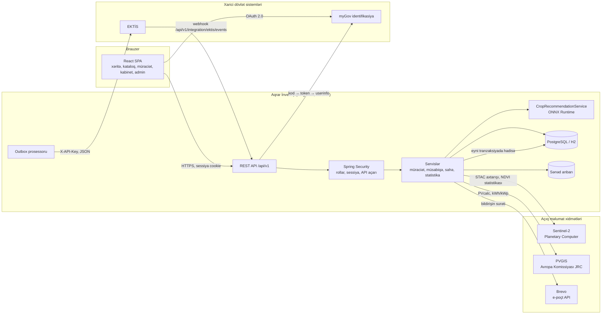
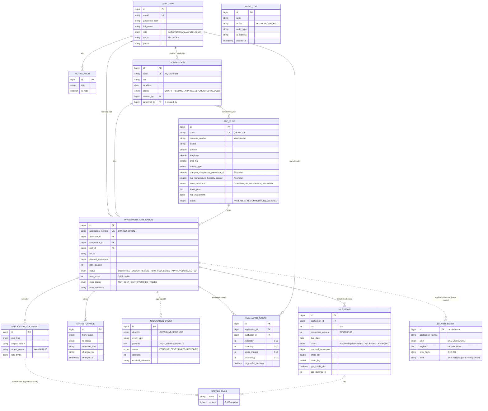
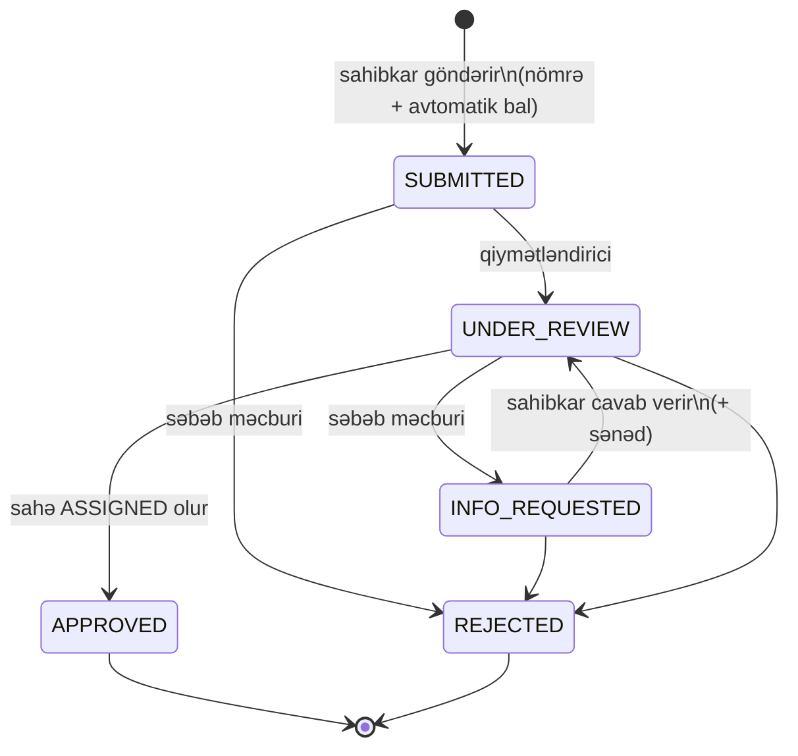
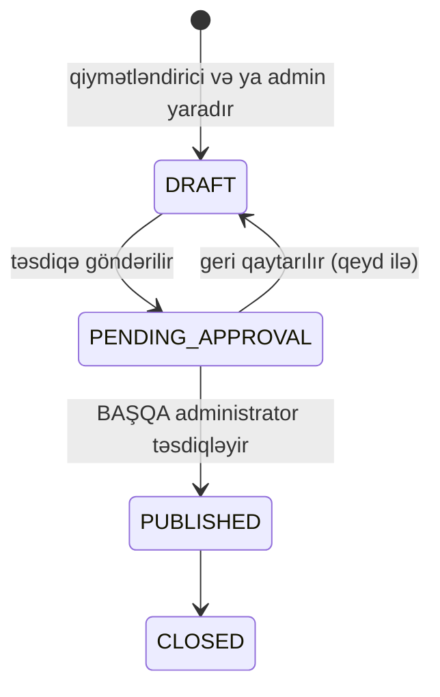
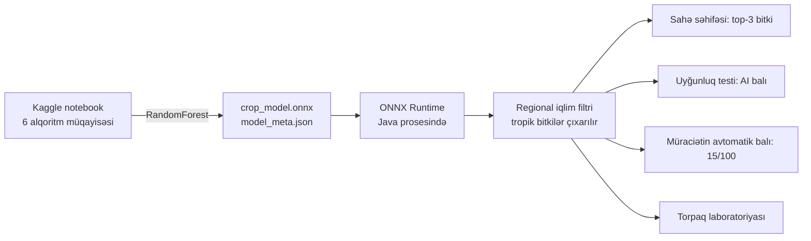
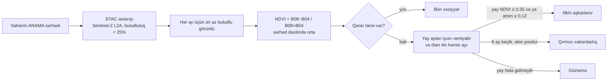

# Arxitektura və məlumat modeli

## Ümumi baxış

**Qatlar** (`backend/src/main/java/az/agro/portal`):

| Paket | Məsuliyyət |
|---|---|
| `domain` | JPA entity-lər və status maşınları (`ApplicationStatus.allowedNext()`) |
| `repo` | Spring Data repozitoriyaları |
| `service` | Biznes qaydaları: müraciət, qiymətləndirmə, dörd göz prinsipi, outbox |
| `web` | REST controller-lər, xəta formatı |
| `security` | Rollar, sessiya, giriş bloku, sistemlərarası API açarı |
| `integration` | `EktisClient`, `MyGovClient` portları və onların simulyatorları |
| `ai` | ONNX modelinin yüklənməsi, regional filtr, fallback |
| `config` | Demo məlumatlar, OpenAPI, SPA marşrutlaması |

Xarici açıq xidmətlərə gedən servislər (`SatelliteService`, `SolarService`, `MailService`) nəticəni yaddaşda saxlayır və xidmət cavab vermədikdə portalın qalanı işləməyə davam edir: istifadəçiyə "xidmət hazırda cavab vermir" göstərilir, e-poçt göndərilməsə yalnız loga yazılır.

Xarici sistemlərə yalnız interfeys vasitəsilə (`EktisClient`, `MyGovClient`) müraciət olunur: real sistemə keçid konfiqurasiya dəyişikliyidir.

## Məlumat modeli (ER diaqramı)

Şəkil və sənədlər diskdə saxlanılır, eyni zamanda `STORED_BLOB`-a surəti yazılır (efemer diskli hostinqdə itməsin). `LEDGER_ENTRY` yalnız əlavə olunur, heç vaxt yenilənmir.

## Müraciətin həyat dövrü

Hər keçid: tarixçəyə yazılır, sahibkara bildiriş gedir, EKTİS-ə `APPLICATION_STATUS_CHANGED` hadisəsi növbəyə qoyulur, audit jurnalına qeyd düşür.

## Müsabiqənin həyat dövrü (dörd göz prinsipi)

## AI komponenti

* Test dəqiqliyi 99.5%, 5-fold CV 99.4%, macro F1 99.5%.
* Model yoxdursa, şəffaf fallback (sentroid evristikası) işləyir və cavabda `engine: FALLBACK` yazılır.
* Diapazondan kənar girişlər (`outOfRange`) istifadəçiyə açıq bildirilir.

## Peyk monitorinqi (NDVI)

Qarabağda yazda yağışdan sonra bütün boş sahələr yaşıllaşır (NDVI 0.3–0.45) və iyulda quruyur. Ona görə yazdakı pik əkin sübutu sayılmır; 18 real sahənin hamısında bu nümunə müşahidə olunub. Qayda `SatelliteService.assess`-dədir və `SatelliteAssessTest` ilə yoxlanılır.

## Günəş enerjisi

* İstehsal potensialı: PVGIS 5.3, sahənin mərkəzi, optimal bucaqlı sabit konstruksiya, 14% itki.
* Uyğunluq balı (100): günəş potensialı 40, minatəmizləmə 25 (təmizlənməyibsə "hazırda uyğun deyil"), şəbəkəyə qoşulma 15, fəaliyyətlə uyğunluq 20.
* Tariflər: Tarif (Qiymət) Şurasının 29.12.2024 tarixli 19 nömrəli qərarı: günəşdən alış 8.5 qəpik/kWh, kənd təsərrüfatı istehlakı 10.6 qəpik/kWh.
* Ssenarilər: aktiv istehlakçı (150 kW-a qədər, Azərişıq şəbəkəsinə qoşulma) və aqrovoltaik stansiya (150 kW-dan yuxarı tarif auksionla müəyyən edilir; hesabda 8.5 qəpik istinad).
* Xərclər (₼/kWp, istismar 1.5%, deqradasiya 0.5%/il, şəbəkənin CO₂ əmsalı 0.45 kq/kWh) planlaşdırma fərziyyələridir və ekranda dəyişdirilə bilər.
