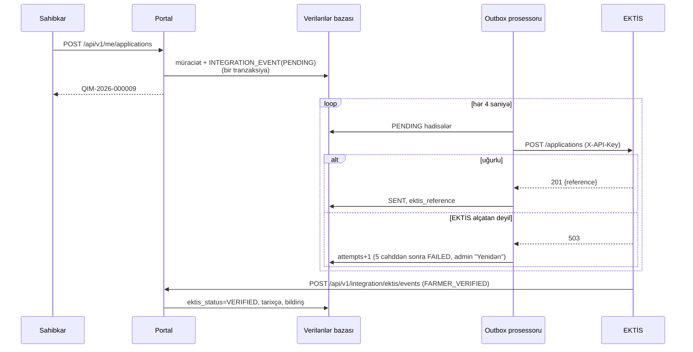
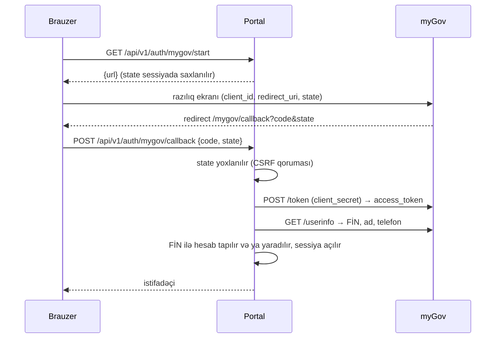

# EKTİS və myGov inteqrasiyası

Real EKTİS və myGov-a qoşulmaq üçün səlahiyyətli qurumun razılığı və texniki şərtləri lazımdır. Prototip eyni
protokolları **simulyatorlarla** nümayiş etdirir. Portal kodu simulyatoru "tanımır": real sistemə keçid yalnız
`application.properties`-dəki ünvan və açarların dəyişməsidir.

## 1. EKTİS: portaldan EKTİS-ə (outbox)



**Niyə outbox?** Müraciət və "EKTİS-ə göndər" hadisəsi eyni tranzaksiyada yazılır. EKTİS dayanıqsız olsa belə heç bir
müraciət itmir, sahibkar gözləmir. Demo: Admin → "EKTİS və AI" → "EKTİS-i söndür".

### Hadisələr

| Hadisə | İstiqamət | Endpoint (EKTİS tərəfi) |
|---|---|---|
| `APPLICATION_SUBMITTED` | Portal → EKTİS | `POST /applications` |
| `APPLICATION_STATUS_CHANGED` | Portal → EKTİS | `POST /applications/{reference}/status` |
| `COMPETITION_PUBLISHED` | Portal → EKTİS | `POST /competitions` |
| `FARMER_VERIFIED` / `FARMER_REGISTERED` | EKTİS → Portal | `POST /api/v1/integration/ektis/events` |
| Fermer reyestri sorğusu | Portal → EKTİS (sinxron) | `GET /farmers/{fin-or-voen}` |

### Nümunə: `APPLICATION_SUBMITTED`

```http
POST {EKTIS_BASE}/applications
X-API-Key: <outbound key>
X-Source-System: AQRAR-INVEST-PORTAL
Content-Type: application/json
```

```json
{
  "schemaVersion": "1.0",
  "applicationNumber": "QIM-2026-000009",
  "submittedAt": "2026-10-14T10:49:08Z",
  "competitionCode": "MQ-2026-002",
  "applicant": { "type": "INDIVIDUAL", "name": "Rəşad Məmmədov", "taxId": "5ZK7QWE", "phone": "+994 55 333 33 33", "email": "investor@demo.az" },
  "plot": { "code": "QR-XCL-001", "cadastreNumber": "10-402-0015-001", "district": "Xocalı", "areaHa": 65.0 },
  "investment": { "activityType": "HORTICULTURE", "plannedCrop": "apple", "amountAzn": 500000, "ownFundsPercent": 30, "jobsCreated": 12, "projectMonths": 36 }
}
```

Cavab: `201 {"reference": "EKTIS-APP-2026-1001", "status": "RECEIVED"}`

### Nümunə: EKTİS-dən webhook

```http
POST {PORTAL}/api/v1/integration/ektis/events
X-API-Key: <inbound key>
```

```json
{
  "eventType": "FARMER_VERIFIED",
  "applicationNumber": "QIM-2026-000009",
  "ektisReference": "EKTIS-APP-2026-1001",
  "message": "Fermer reyestrində təsdiqləndi (Rəşad Məmmədov)",
  "data": { "taxId": "5ZK7QWE", "checkedAt": "2026-10-14T10:49:11Z" }
}
```

### Açarlar (mühit dəyişənləri)

| Dəyişən | Məna |
|---|---|
| `app.ektis.base-url` | EKTİS gateway ünvanı (demo: daxili simulyator) |
| `EKTIS_API_KEY` | Portalın EKTİS-ə göndərdiyi açar |
| `INTEGRATION_API_KEY` | EKTİS-in portala webhook üçün göndərdiyi açar |

Açarlar sabit vaxtlı müqayisə ilə yoxlanılır. İstehsalda mTLS və ya IP siyahısı əlavə olunmalıdır.

## 2. myGov ilə giriş (OAuth 2.0 authorization code)



* Kod və token birdəfəlikdir və 2 dəqiqəyə bitir.
* `client_secret` yalnız serverdədir, brauzerə heç vaxt getmir.
* Konfiqurasiya: `app.mygov.authorize-url`, `api-base-url`, `client-id`, `MYGOV_CLIENT_SECRET`, `redirect-uri`.

## 3. Açıq API

Bütün endpoint-lər Swagger-də: `http://localhost:8080/swagger-ui.html` (OpenAPI 3: `/v3/api-docs`).
Canlı versiya: `https://aqrar-invest.vercel.app/swagger-ui.html`.

Əsas ictimai endpoint-lər (giriş tələb etmir):

| Endpoint | Təyinat |
|---|---|
| `GET /api/v1/public/plots`, `/plots/{id}` | Sahələr, filtrlər (rayon, fəaliyyət, minatəmizləmə, sahə, açıq müsabiqə) |
| `GET /api/v1/public/plots/{id}/recommendation` | AI bitki tövsiyəsi |
| `GET /api/v1/public/plots/{id}/climate` | 10 illik iqlim göstəriciləri və bitkilər üzrə risk |
| `GET /api/v1/public/plots/{id}/satellite` | Sentinel-2 NDVI tarixçəsi, monitorinq qiymətləndirməsi, görüntü linkləri |
| `GET /api/v1/public/plots/{id}/solar` | Günəş uyğunluğu, PVGIS istehsalı, tariflər |
| `GET /api/v1/public/verify/{nömrə}` | Qəbzin həqiqiliyi |
| `GET /api/v1/public/verify/{nömrə}/ledger` | Qərarların hash zənciri ilə yoxlanması |
| `GET /api/v1/public/open-data/ocds` | Müsabiqələr və qaliblər, OCDS 1.1 release package |
| `GET /api/v1/public/status` | Açıq kanallar (e-poçt, LLM) və baza növü |

## 4. Açıq məlumat xidmətləri

Hamısı pulsuzdur və açar tələb etmir (Brevo istisna). Hər biri ayrıca servisdə keşlənir; xidmət cavab vermədikdə
yalnız həmin bölmə "xidmət hazırda cavab vermir" göstərir, portalın qalanı işləyir.

| Xidmət | Servis | Sorğu | Nə üçün |
|---|---|---|---|
| Microsoft Planetary Computer (STAC + data API) | `SatelliteService` | STAC axtarışı (sahənin poliqonu, buludluluq < 25%), `item/statistics` NDVI ifadəsi ilə, `item/bbox/*.png` görüntülər | Peyk monitorinqi |
| PVGIS 5.3 (Avropa Komissiyası JRC) | `SolarService` | `PVcalc`, optimal bucaq | Günəş potensialı |
| Open-Meteo archive (ERA5) | `ClimateService` | 2015–2024 gündəlik maks./min. temperatur, yağıntı | İqlim riski |
| opendata.az / azstat API | `OfficialDataService`, `tools/opendata/fetch.mjs` | ANAMA shapefile, statistika CSV | Sahə sərhədləri, rayon statistikası |
| Brevo transactional API | `MailService` | `POST /v3/smtp/email` (`BREVO_API_KEY`) | Bildirişlərin e-poçt surəti |

## 5. Qərar jurnalının müstəqil yoxlanması

Jurnalın hər qeydi `hash = SHA-256(prevHash | müraciət nömrəsi | növ | payload)`, ilk qeyd üçün `prevHash = 64 × "0"`.
`/api/v1/public/verify/{nömrə}/ledger` cavabındakı `entries[].hash` və `prevHash` dəyərləri ilə zənciri istənilən
proqramla yenidən hesablamaq olar. İstehsal mühitində jurnalın son hash-i (`headHash`) dövri olaraq Nazirliyin
saytında dərc olunmalıdır: onda bazanın inzibatçısı belə zənciri gizlicə yenidən yaza bilməz.
